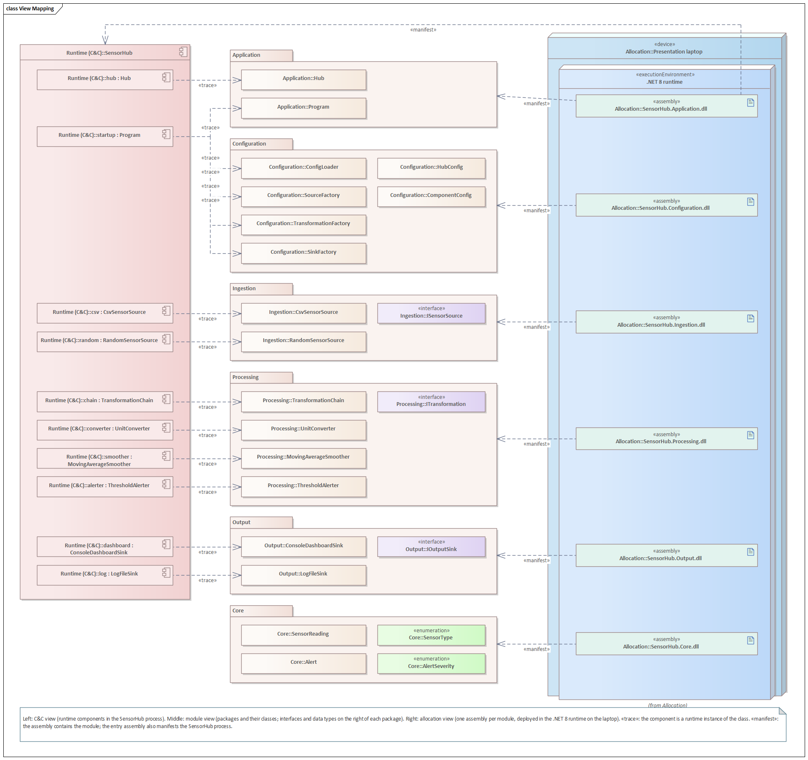

# Sensor Data Processing Hub - Mapping Between Views

The architecture is documented in three views:

- the **module view** (`SensorHub_Module_View.md`): how the code is decomposed, which module uses which, the classes;
- the **component-and-connector view** (`SensorHub_CnC_View.md`): what runs and how it interacts;
- the **allocation view** (`SensorHub_Allocation_View.md`): where the code is built and where it runs.

This document shows how an element of one view corresponds to the elements of the other two, and how this mapping is kept consistent. The mapping is not only written here: it is stored in the UML model (`Documentation/SensorHub.qea`) as relationships, and it was checked against the model (section 5).

In the UML model, the mapping is drawn in the diagram **View Mapping** (package `SensorHub`):

Each horizontal band is one module. Left: its C&C components inside the `SensorHub` process. Middle: the module (package) and its classes, with the classes that become components on the left and the interfaces and data types on the right. Right: the assembly built from the module, deployed in the .NET 8 runtime on the laptop. `«trace»` arrows go from a component to its class, `«manifest»` arrows from an assembly to its module; the entry assembly also manifests the `SensorHub` process (arrow along the top).

## 1. How the views are linked in the model

| Link in the model | From | To | Meaning |
|---|---|---|---|
| `«trace»` dependency | C&C component | Class (module view) | The component is a runtime instance of that class |
| `«manifest»` dependency | Assembly (allocation view) | Module package (module view) | The assembly contains the code of that module |
| `«manifest»` dependency | `SensorHub.Application.dll` | `SensorHub` boundary (C&C view) | Running the entry assembly creates the hub process |
| `«reference»` dependency | Assembly | Assembly | A `<ProjectReference>`. Same graph as the `«use»` dependencies between modules |
| Nesting | Assembly / file | .NET runtime / laptop node | The assembly or file is deployed there |
| Shared element | `config.json`, `data/room-a.csv`, `hub.log` | - | The same artifacts appear in the C&C view («read» / «write») and in the deployment diagram |

## 2. Element mapping

One row per element of the module view. The **C&C** column says what the element becomes at runtime, the **Allocation** columns say where it is built and where it runs.

| Module | Element | C&C view | Assembly | Runs in |
|---|---|---|---|---|
| Application | `Program` | `startup` (with the classes of Configuration below) | `SensorHub.Application.dll` | .NET 8 runtime, laptop |
| Application | `Hub` | `hub` | `SensorHub.Application.dll` | idem |
| Configuration | `ConfigLoader`, `SourceFactory`, `TransformationFactory`, `SinkFactory` | `startup` | `SensorHub.Configuration.dll` | idem |
| Configuration | `HubConfig`, `ComponentConfig` | Data held by `startup` while it builds the components (not a component) | `SensorHub.Configuration.dll` | idem |
| Ingestion | `ISensorSource` «interface» | Connector `ISensorSource` (`hub` → sources) | `SensorHub.Ingestion.dll` | idem |
| Ingestion | `CsvSensorSource` | `csv` | `SensorHub.Ingestion.dll` | idem |
| Ingestion | `RandomSensorSource` | `random` | `SensorHub.Ingestion.dll` | idem |
| Processing | `ITransformation` «interface» | Connectors `ITransformation` (`hub` → `chain`) and `ITransformation {1..3}` (`chain` → steps) | `SensorHub.Processing.dll` | idem |
| Processing | `TransformationChain` | `chain` | `SensorHub.Processing.dll` | idem |
| Processing | `UnitConverter` | `converter` | `SensorHub.Processing.dll` | idem |
| Processing | `MovingAverageSmoother` | `smoother` | `SensorHub.Processing.dll` | idem |
| Processing | `ThresholdAlerter` | `alerter` | `SensorHub.Processing.dll` | idem |
| Output | `IOutputSink` «interface» | Connector `IOutputSink` (`hub` → sinks) | `SensorHub.Output.dll` | idem |
| Output | `ConsoleDashboardSink` | `dashboard` | `SensorHub.Output.dll` | idem |
| Output | `LogFileSink` | `log` | `SensorHub.Output.dll` | idem |
| Core | `SensorReading`, `Alert` | Data carried by the call connectors (not components) | `SensorHub.Core.dll` | idem |
| Core | `SensorType`, `AlertSeverity` «enumeration» | Values inside the data | `SensorHub.Core.dll` | idem |
| (all modules) | - | `SensorHub` boundary: the whole process | `SensorHub.Application.dll` loads the five other assemblies | idem |

What the mapping shows:

- **Classes become components, interfaces become connectors, Core types become data.** Every class with behavior corresponds to exactly one component (the startup classes share `startup`); every interface is the type of a connector; the Core types travel on the connectors. `HubConfig` and `ComponentConfig` are data used by `startup`, not components.
- **One module, one assembly.** Each column "Assembly" value is the module of the row.
- **`startup` is the only component that spans two modules** (Application and Configuration). It is the startup phase as a whole: `Program` drives it, the classes of Configuration do the work. Its two connectors to `hub` (`«create»` and `Run()`) are issued by `Program`, so they stay inside Application. This is written in the notes of those connectors.

## 3. Relationship mapping

Each `«use»` dependency of the uses view, the C&C connectors it allows, and the project reference that implements it.

| Uses view (module → module) | C&C view | Allocation view (`«reference»`) |
|---|---|---|
| Application → Configuration | inside `startup`: `Program` calls `ConfigLoader` and the factories (not drawn, same component) | Application → Configuration |
| Application → Ingestion | `hub` → `csv`, `random` (`ISensorSource`) | Application → Ingestion |
| Application → Processing | `hub` → `chain` (`ITransformation`) | Application → Processing |
| Application → Output | `hub` → `dashboard`, `log` (`IOutputSink`) | Application → Output |
| Application → Core | `SensorReading` passed on every call of `hub` | Application → Core |
| Configuration → Ingestion | the factories create `csv` and `random` at startup (inside `startup`, not drawn) | Configuration → Ingestion |
| Configuration → Processing | the factories create `chain` and its steps at startup | Configuration → Processing |
| Configuration → Output | the factories create `dashboard` and `log` at startup | Configuration → Output |
| Configuration → Core | the factories turn the sensor type of `config.json` into a `SensorType` | Configuration → Core |
| Ingestion → Core | the sources produce `SensorReading` | Ingestion → Core |
| Processing → Core | the steps read and change `SensorReading`, add `Alert` | Processing → Core |
| Output → Core | the sinks show and write `SensorReading` and `Alert` | Output → Core |
| (Processing → Processing) | `chain` → `converter`, `smoother`, `alerter` (`ITransformation {1..3}`) | inside `SensorHub.Processing.dll` |

The three columns have the same dependencies. No C&C connector links two components whose modules may not use each other, and no project reference exists without a `«use»` dependency.

## 4. Files

| File | Module view | C&C view | Allocation view |
|---|---|---|---|
| `config.json` | Read by `ConfigLoader`, parsed into `HubConfig` (Configuration) | `startup` «read» | Artifact in the output folder on the laptop |
| `data/room-a.csv` | Read by `CsvSensorSource` (Ingestion) | `csv` «read» | Artifact in `data/` in the output folder |
| `hub.log` | Written by `LogFileSink` (Output) | `log` «write» | Artifact in the output folder (path from `config.json`) |
| Console | Written by `ConsoleDashboardSink` (Output) | `Console` «external», `dashboard` «write» | The terminal where the hub is started |

## 5. Consistency checks

The mapping was checked by querying the relationships stored in the UML model against five rules:

| # | Rule | Result (20.11.2026) |
|---|---|---|
| 1 | Each module package is manifested by exactly one assembly | 6 / 6 |
| 2 | Each C&C component (except the boundary and `Console`) traces to at least one class | 10 / 10 |
| 3 | Each connector between C&C components is allowed by the uses view (same module, or a `«use»` dependency; for `startup`, one of its modules must be allowed) | 10 / 10 |
| 4 | The `«reference»` dependencies are exactly the `«use»` dependencies | 12 = 12, identical |
| 5 | Each deployed assembly is nested in the .NET runtime | 6 / 6 |

All five rules hold. Rule 3 is the one that ties the C&C view to the module view: no component calls a component whose module it is not allowed to use. Rule 4 ties the allocation view to the module view: the build cannot contain a dependency that the uses view forbids. These rules should be checked again after any change to the model, so that the views cannot drift apart.

## 6. Following a change through the views

The mapping is what makes the modifiability scenarios measurable: a change is located in one view and its cost is read in the others.

**Add a sink (e.g. CSV export).**

- Module view: one new class `CsvExportSink` in Output, realising `IOutputSink`; one entry in `SinkFactory`. No other module changes.
- C&C view: one new component `export` on the existing `IOutputSink` connector of `hub`, and one new file «write». No other connector changes.
- Allocation view: `SensorHub.Output.dll`, `SensorHub.Configuration.dll` and `SensorHub.Application.dll` are recompiled; Ingestion, Processing and Core are not. One new artifact `export.csv` on the laptop.

**Change the smoothing window or a threshold.**

- Module view: nothing.
- C&C view: same components and connectors, one parameter of `smoother` or `alerter` changes.
- Allocation view: only `config.json` changes. No assembly is recompiled.

**Add a socket feed source.**

- Module view: one new class in Ingestion realising `ISensorSource`; one entry in `SourceFactory`.
- C&C view: one new source component on the `ISensorSource` connector of `hub`. Because `hub` reads in a single thread, a blocking socket would stop the loop: see the rationale of the C&C view.
- Allocation view: a second node (sensor gateway) connected over TCP; `SensorHub.Ingestion.dll`, `SensorHub.Configuration.dll` and `SensorHub.Application.dll` are recompiled.
