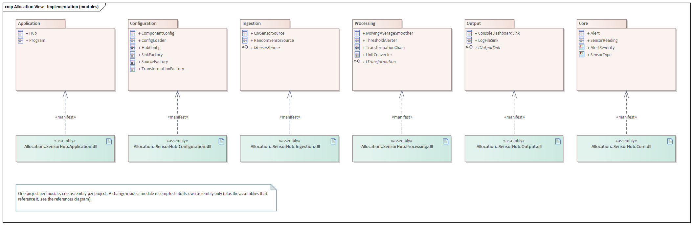
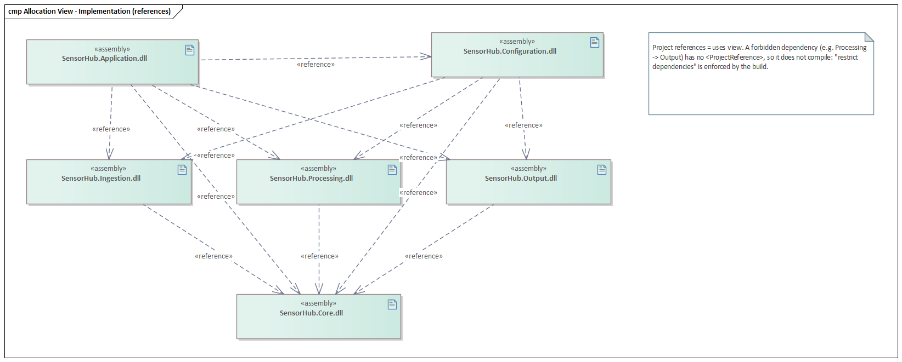
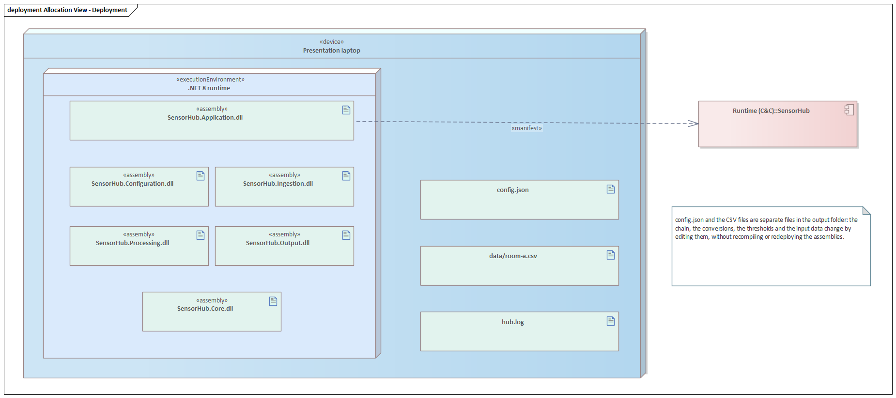

# Sensor Data Processing Hub - Allocation View

This document describes the allocation view of the Sensor Data Processing Hub: how the software maps to things outside the software. The module view shows how the code is organised and the C&C view shows what runs. This view shows **where the code is built** (projects and assemblies) and **where it runs** (machine, runtime, files).

The view is written to show modifiability: for each likely change, it tells which project is edited, which assemblies are rebuilt and what is redeployed.

In the UML model, the view is made of three diagrams. The two last ones are in the package `SensorHub / Allocation`; the first one is in the package `SensorHub`, next to the module packages it shows (this way EA does not print "(from SensorHub)" under each package):

| Diagram | Style | Shows |
|---|---|---|
| Allocation View - Implementation (modules) | Implementation | Each module and the assembly built from it |
| Allocation View - Implementation (references) | Implementation | The project references between the assemblies |
| Allocation View - Deployment | Deployment | The machine, the .NET runtime, the assemblies and the files |

A work assignment view is not included: it brings little for a project of this size.

## 1. Implementation: modules to assemblies



Each module of the module view is one C# project, built into one assembly. The `«manifest»` dependency says that the assembly contains the code of the module.

| Module | Project folder | Assembly | Namespace |
|---|---|---|---|
| Application | `code/src/SensorHub.Application/` | `SensorHub.Application.dll` (entry assembly) | `SensorHub.Application` |
| Configuration | `code/src/SensorHub.Configuration/` | `SensorHub.Configuration.dll` | `SensorHub.Configuration` |
| Ingestion | `code/src/SensorHub.Ingestion/` | `SensorHub.Ingestion.dll` | `SensorHub.Ingestion` |
| Processing | `code/src/SensorHub.Processing/` | `SensorHub.Processing.dll` | `SensorHub.Processing` |
| Output | `code/src/SensorHub.Output/` | `SensorHub.Output.dll` | `SensorHub.Output` |
| Core | `code/src/SensorHub.Core/` | `SensorHub.Core.dll` | `SensorHub.Core` |

Other files in the source tree:

| File | Role |
|---|---|
| `code/config.json` | Default configuration of the hub. Copied by the build to the output folder |
| `code/data/*.csv` | Input data. Copied by the build to `data/` in the output folder |
| `code/SensorHub.sln` | Solution that builds every project |

In .NET 8 every project, including the entry project, is built into a `.dll`. The build also creates a small launcher next to the entry assembly (`SensorHub.Application.exe` on Windows); it only starts `SensorHub.Application.dll` and is not a separate module.

## 2. Implementation: project references



A `«reference»` dependency is a `<ProjectReference>` in the `.csproj` file. The references are **exactly the dependencies of the uses view**, drawn in the same layout:

| Project | References |
|---|---|
| `SensorHub.Application` | Configuration, Ingestion, Processing, Output, Core |
| `SensorHub.Configuration` | Ingestion, Processing, Output, Core |
| `SensorHub.Ingestion` | Core |
| `SensorHub.Processing` | Core |
| `SensorHub.Output` | Core |
| `SensorHub.Core` | none |

Because a project can only use the types of the projects it references, a forbidden dependency does not compile. For example, `SensorHub.Processing` has no reference to `SensorHub.Output`, so a `using SensorHub.Output;` in a transformation is a build error. The rules of the uses view are checked by the compiler on every build, not only by code review.

## 3. Deployment



| Element | Type | Content |
|---|---|---|
| Presentation laptop | Node «device» | Any machine with the .NET 8 SDK (Windows, Linux or macOS) |
| .NET 8 runtime | Execution environment | Installed with the SDK. Runs the hub as one process |
| `SensorHub.Application.dll` and the five module assemblies | Artifacts «assembly» | The build output. The entry assembly manifests the `SensorHub` process of the C&C view |
| `config.json` | Artifact | Read once at startup |
| `data/room-a.csv` | Artifact | Input data of the CSV source |
| `hub.log` | Artifact | Written by the log sink. Its path is set in `config.json` |
| Terminal | (not drawn) | The console dashboard is shown in the terminal where the hub is started, on the same laptop. It is the `Console` of the C&C view |

Everything is in one output folder on one machine. **Path rule:** the first program argument is the path of the configuration file. Without an argument, `config.json` is used. A relative path (for the configuration, the CSV files or the log) is resolved against the output folder, not against the current directory, so the hub finds its files wherever it is started from.

Running the hub from the repository (the SDK builds it first):

```
dotnet run --project code/src/SensorHub.Application
dotnet run --project code/src/SensorHub.Application -- other-config.json
```

`dotnet run` needs the SDK. An already built output folder only needs the runtime: `dotnet SensorHub.Application.dll`.

## 4. Modifiability: impact of likely changes

The response measure of a change is what has to be edited, recompiled and redeployed. The table uses the project references above: when a project changes, the projects that reference it are recompiled too.

| Change | Edited | Assemblies recompiled | Redeployed |
|---|---|---|---|
| Change the chain order, a conversion, a threshold or a window size | `config.json` (the copy in the output folder, or any file passed as argument) | none | nothing, restart the hub |
| Use another input file | a CSV file and `config.json` | none | the CSV file, placed in `data/` |
| Add a transformation (e.g. a median filter) | one class in Processing, one entry in `TransformationFactory`, `config.json` | Processing, Configuration, Application | the output folder |
| Add a source (e.g. a socket feed) | one class in Ingestion, one entry in `SourceFactory`, `config.json` | Ingestion, Configuration, Application | the output folder |
| Add a sink (e.g. CSV export) | one class in Output, one entry in `SinkFactory`, `config.json` | Output, Configuration, Application | the output folder |
| Change a shared data type in Core | Core and every module that uses the changed member | all six | the output folder |

What the table shows:

- **The most frequent changes need no compilation.** Conversions, thresholds and the chain are in `config.json`, a file next to the binaries, not compiled into them. Editing `code/config.json` in the source tree only needs a build to copy it, or the file can be passed directly as argument.
- **A new source, transformation or sink never touches the other two kinds.** Adding a sink does not rebuild `SensorHub.Ingestion.dll` or `SensorHub.Processing.dll`, because neither references `SensorHub.Output`.
- **Core is the expensive one.** It is referenced by every project, so the module view keeps it to plain data types that should rarely change.

## 5. Rationale

| Decision | Tactic | Because |
|---|---|---|
| One project and one assembly per module | Encapsulate | The assembly boundary makes the interface of a module explicit: other modules see only its `public` types, helpers can stay `internal`. A change inside a module is compiled into one assembly |
| Project references = uses view | Restrict dependencies | The compiler rejects a forbidden dependency, so the module structure cannot erode silently |
| `config.json` and data files outside the binaries | Defer binding (configuration-time binding) | The chain, the conversions, the thresholds and the input change by editing files, without rebuilding or redeploying |
| Path of `config.json` given as a program argument | Defer binding (startup-time binding) | Several configurations can be kept side by side and chosen at launch, for example one per demo |
| Relative paths resolved against the output folder | - | The hub behaves the same whatever directory it is started from, which avoids "file not found" during the demo |
| One machine, one process | Simplicity | Nothing to install or connect for the demo. The single node keeps the deployment trivial |

**Future socket feed.** A socket source would add a second node (a sensor gateway) connected to the laptop over TCP. On the laptop, only `SensorHub.Ingestion.dll` (new source class), `SensorHub.Configuration.dll` (factory entry) and `SensorHub.Application.dll` (recompiled because it references them) change; Processing, Output and Core are unchanged. Because `hub` reads its sources in a single thread, a blocking socket would also require the concurrent variant described in the C&C view. This is a candidate modifiability scenario.

## 6. Modelling choices

| Choice | Alternative considered | Because |
|---|---|---|
| The implementation part is split into two diagrams: modules → assemblies, and references between assemblies | One diagram with packages, assemblies, manifests and references | With both, the 12 `«use»` arrows of the packages and the 12 `«reference»` arrows of the assemblies crossed each other and the diagram was unreadable |
| The references diagram uses the same layout as the uses view | Any layout | Putting the two diagrams side by side shows at a glance that the graphs are the same |
| `«reference»` stereotype on the dependencies between assemblies | Plain `«use»` | It names the C# mechanism (`<ProjectReference>`) and keeps it apart from the `«use»` relation between modules |
| The assemblies are nested in the .NET runtime node, the files in the laptop node | `«deploy»` arrows from each artifact to the node | Nesting is the UML notation for "deployed on". Seven `«deploy»` arrows would only add lines |
| `config.json`, `data/room-a.csv` and `hub.log` are the same model elements as in the C&C view | Separate artifacts for each view | One element per file, so the two views cannot disagree. In the C&C diagram, they appear as `Allocation::config.json` because they are owned by this view |
| The entry assembly `SensorHub.Application.dll` `«manifest»` the C&C `SensorHub` component | No link between deployment and C&C | It is the mapping between the two views: running this artifact creates that process |

## 7. Mapping to the other views

Summary below. The complete mapping between the three views, and how its consistency was checked, are in `SensorHub_View_Mapping.md`.

| Allocation element | Module view | C&C view |
|---|---|---|
| `SensorHub.<Module>.dll` | Module `<Module>` (`«manifest»`) | The components whose classes are in that module |
| `«reference»` between assemblies | `«use»` between modules | Every connector between components of two modules |
| `SensorHub.Application.dll` (entry assembly) | Application | The `SensorHub` process (`«manifest»`) |
| `config.json`, `data/room-a.csv`, `hub.log` | Read and written by Configuration, Ingestion, Output | Same elements, `«read»` / `«write»` |
| Terminal of the laptop | Written by `ConsoleDashboardSink` (Output) | `Console` «external» |

## 8. Gap with the current code

The view describes the target structure. The current code does not match it yet:

- the projects `SensorHub.Configuration` and `SensorHub.Output` do not exist;
- `SensorHub.Application` references only Core and Ingestion;
- there is no `config.json`, and the build copies `data/sample.csv` only;
- `Program` does not take the configuration path as argument yet (the path rule of §3 is to be implemented).

These gaps are closed when the code is aligned with the UML model.
