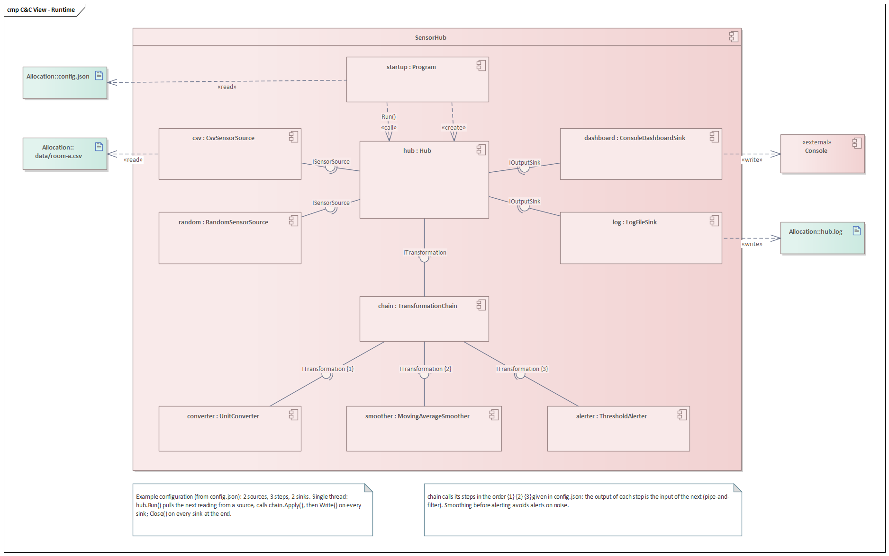

# Sensor Data Processing Hub - Component-and-Connector View

This document describes the component-and-connector (C&C) view of the Sensor Data Processing Hub: the runtime components, the connectors between them, how the system behaves at runtime, and why it is built this way. The module view (`SensorHub_Module_View.md`) shows how the code is organised. This view shows what exists and interacts **while the hub runs**.

In the UML model, the view is the diagram **C&C View - Runtime** in the package `SensorHub / Runtime (C&C)`.

## 1. Overview

- **Style:** call-return with a central mediator. `hub` is the only component that calls the sources, the chain and the sinks; they never call each other. Inside the chain, the steps form a **pipe-and-filter** sequence: the output of one step is the input of the next. The chain realises it by calling the steps one after the other.
- **Concurrency:** a single thread, the main thread. `startup` builds everything, calls `hub.Run()` and waits until it returns.
- **Configuration:** all components are created and wired once, at startup, from `config.json`. The diagram shows an example configuration: one CSV source, one random source, three steps and two sinks.
- **Boundary:** the large `SensorHub` component is the hub process. The components inside it are its runtime parts (`name : Type`). The files and the console are outside: the process only reads or writes them.

## 2. Element catalog

### 2.1 Components

| Component | Type (module view) | Responsibility | Interfaces |
|---|---|---|---|
| `SensorHub` | - (the whole executable) | The hub process. Contains every component below except `Console` | - |
| `startup` | `Program`, `ConfigLoader`, `SourceFactory`, `TransformationFactory`, `SinkFactory` | Reads `config.json`, creates every component and wires them, then calls `hub.Run()` | - |
| `csv` | `CsvSensorSource` | Streams readings from a CSV file | provides `ISensorSource` |
| `random` | `RandomSensorSource` | Generates simulated readings | provides `ISensorSource` |
| `hub` | `Hub` | Runs the processing loop | requires `ISensorSource`, `ITransformation`, `IOutputSink` |
| `chain` | `TransformationChain` | Calls its steps in the configured order | provides and requires `ITransformation` |
| `converter` | `UnitConverter` | Linear unit conversion (e.g. °C to °F) | provides `ITransformation` |
| `smoother` | `MovingAverageSmoother` | Moving average per (sensor, type) | provides `ITransformation` |
| `alerter` | `ThresholdAlerter` | Adds Warning or Critical alerts to the reading | provides `ITransformation` |
| `dashboard` | `ConsoleDashboardSink` | Shows the latest value and alerts per (sensor, type) | provides `IOutputSink` |
| `log` | `LogFileSink` | Appends each processed reading and its alerts to a file | provides `IOutputSink` |
| `Console` «external» | - | Standard output of the process | - |

The steps are drawn next to `chain`, not inside it. In the module view, `TransformationChain` holds its steps by **aggregation** (a step can exist without the chain), not by composition. They are inside `SensorHub`, because every component lives exactly as long as the process.

### 2.2 Data stores

| Artifact | Used by | Content |
|---|---|---|
| `config.json` | `startup` (read) | Sources, transformation chain (steps, order, conversions, thresholds), sinks |
| `data/room-a.csv` | `csv` (read) | `timestamp,sensor_id,type,value,unit` |

The three files are owned by the allocation view (they are deployed next to the executable), which is why the diagram shows them as `Allocation::config.json`, and so on. The C&C view and the allocation view use the same model elements.
| `hub.log` | `log` (write) | One line per processed reading, with its alerts |

### 2.3 Connectors

| Connector | Between | Kind | Semantics |
|---|---|---|---|
| `Run()` «call» | `startup` → `hub` | Synchronous call | Starts the loop. Returns when every source is exhausted |
| «create» | `startup` → `hub` | Creation (startup only) | `startup` creates `hub` and every component it is wired to |
| `ISensorSource` (assembly) | `hub` → `csv`, `random` | Synchronous call, pull | `hub` asks a source for its next `SensorReading` |
| `ITransformation` (assembly) | `hub` → `chain` | Synchronous call | `hub` passes a reading and gets the transformed reading back, with its alerts |
| `ITransformation {1}`, `{2}`, `{3}` (assembly) | `chain` → `converter`, `smoother`, `alerter` | Synchronous call, ordered | `chain` calls each step in config order and passes the result of step n to step n+1 |
| `IOutputSink` (assembly) | `hub` → `dashboard`, `log` | Synchronous call, push | `Write()` for each processed reading, `Close()` once at the end |
| «read» / «write» | components → artifacts, `Console` | File / stream I/O | Configuration, input data and outputs |

In an assembly connector, the ball is on the side that **provides** the interface and the socket on the side that **requires** it. The call goes from the socket to the ball. The data travelling on every call is a `SensorReading`, which carries its alerts.

## 3. Behavior

1. **Startup.** `startup` reads `config.json`. The factories create the sources, the steps (added to `chain` in the configured order) and the sinks. `startup` creates `hub` with them and calls `hub.Run()`.
2. **Loop.** `hub` repeats: take the next reading from a source, call `chain.Apply(reading)`, then call `Write(reading)` on each sink. `chain.Apply` calls `converter`, `smoother` and `alerter` in turn. Sources are read in turn (round-robin) or one after the other (sequential); this variant is still to be fixed.
3. **End.** When every source is exhausted, `hub` calls `Close()` on every sink, so the log file is flushed and closed, and `Run()` returns.

Everything runs in one thread, so the state kept by `smoother` and `dashboard` needs no locking.

## 4. Variability

The configuration file sets, without any code change:

- how many sources there are and of which kind (CSV file, random generator);
- which steps the chain contains, in which order, with which parameters (conversion factor and offset, window size, thresholds);
- which sinks are used.

## 5. Rationale

| Decision | Tactic / pattern | Because |
|---|---|---|
| `hub` is the only component that calls sources, chain and sinks | Use an intermediary (mediator), restrict dependencies | Sources, steps and sinks are independent at runtime: a new sink never affects a source |
| Steps chained in a sequence, all behind `ITransformation` | Pipe-and-filter | A step can be added, removed or moved without changing the others |
| `hub` sees one `ITransformation`, not the steps | Encapsulate (Composite pattern) | `hub` does not change when the number or the order of the steps changes |
| Example order: convert, then smooth, then alert | Configuration choice | Thresholds are written in the converted unit, and alerting on smoothed values avoids alerts caused by a single noisy reading. Another order only needs a change in `config.json` |
| Components created from `config.json` at startup | Defer binding (configuration-time binding) | The chain, the conversions and the sinks change by editing the file, without a rebuild |
| One thread, `hub` pulls the readings | Simplicity over concurrency | Deterministic behavior, easy to test and to demo. Stateful steps need no locks |

The single-thread choice has a known cost: a source that blocks (for example a future socket feed waiting for data) stops the whole hub. The alternative is to run each source in its own task and let them fill a queue that `hub` consumes (producer/consumer, the *introduce concurrency* tactic). The interfaces would not change: only `hub` would gain a private queue. This is kept as a modifiability scenario rather than built now.

## 6. Modelling choices

These choices are about how the view is drawn in UML, not about the system itself. Each one was made so that the diagram says exactly what happens at runtime and agrees with the module view.

| Choice | Alternative considered | Because |
|---|---|---|
| The runtime components are parts (`name : Type`) inside a `SensorHub` boundary that stands for the process | Free-standing components on the diagram | Without a boundary, nothing shows what runs in the process and what is external. `Console` was only told apart by its stereotype. The boundary is also the element the allocation view places on the machine |
| Assembly connectors drawn directly between components, named after the interface (`ISensorSource`, `ITransformation`, `IOutputSink`). The ball is on the provider, the socket on the requirer | Provided and required interfaces drawn on each component, then linked by assembly connectors | With interfaces on the components, the tool draws the ball and socket twice (once on each component, once on the connector), which is hard to read. Naming the connector after the interface keeps the link with the module view |
| `chain` is linked to each step by an ordered connector `ITransformation {1}`, `{2}`, `{3}` | Data-flow arrows `SensorReading` from `converter` to `smoother` to `alerter` | A C&C connector is a runtime interaction. The steps never call each other: `chain` calls each one in turn and passes the result on. Flow arrows between steps would show an interaction that does not exist. The pipe-and-filter idea is kept in the text and in a note, as the logical sequence of the data |
| The steps are drawn next to `chain`, not inside it | Steps nested inside `chain` | Nesting reads as composition, but the module view says aggregation (`0..1`): a step can exist without a chain. The two views would contradict each other |
| `startup` → `hub` has two connectors: `«create»` and `Run() «call»` | Only `«create»` | `startup` (the main thread) does not stop after building the components: it calls `hub.Run()` and waits for it. Creation happens once at startup, the call is the runtime entry point, so they are kept apart |
| The startup phase is in the same diagram as the processing loop | A runtime-only diagram, with startup left out | Creating the components from `config.json` is the *defer binding* tactic, one of the main decisions of the architecture. Leaving it out would hide where the configuration comes in |
| Files are artifacts and the console is an «external» component, linked by `«read»` and `«write»` | Leaving the files out, or drawing them as components | They are not part of the system, but the view must show what it reads and writes. Artifacts are the UML element for files |
| One example configuration (2 sources, 3 steps, 2 sinks), stated in a note | Showing multiplicities instead of instances | A C&C view shows instances. The general multiplicities (`1..*` sources and sinks, `0..*` steps) are in the module view, so the note only says that this is one possible configuration |
| Each component is linked to its class by a `«trace»` dependency that is not drawn | Drawing the classes in the C&C diagram | The classes would double the size of the diagram. The `«trace»` links keep the mapping in the model (§7) without cluttering the view |
| The two notes are not attached to an element | Notes linked to `hub` and `chain` | Their links crossed the boundary and other components. The text names the element it talks about |

## 7. Mapping to the module view

Each component is linked to the class it instantiates by a `«trace»` dependency in the UML model. The complete mapping between the three views, and how it is checked, is in `SensorHub_View_Mapping.md`.

| C&C element | Module view element | Module |
|---|---|---|
| `startup` | `Program`, `ConfigLoader`, the three factories | Application, Configuration |
| `hub` | `Hub` | Application |
| `csv`, `random` | `CsvSensorSource`, `RandomSensorSource` | Ingestion |
| `chain`, `converter`, `smoother`, `alerter` | `TransformationChain`, `UnitConverter`, `MovingAverageSmoother`, `ThresholdAlerter` | Processing |
| `dashboard`, `log` | `ConsoleDashboardSink`, `LogFileSink` | Output |
| Connectors `ISensorSource`, `ITransformation`, `IOutputSink` | Interfaces of the same name | Ingestion, Processing, Output |
| Connector `Run()` | Operation `Hub.Run()` | Application |
| Data on the call connectors (`ISensorSource`, `ITransformation`, `IOutputSink`) | `SensorReading`, `Alert` | Core |
| `SensorHub` boundary | The whole solution, built as one executable | All (the entry assembly `SensorHub.Application.dll` manifests it, see `SensorHub_Allocation_View.md`) |

Every connector corresponds to a dependency allowed by the uses view: `Application` uses `Ingestion`, `Processing` and `Output` through their interfaces, and `chain` → steps stays inside `Processing`. No connector links two components whose modules are not allowed to use each other.
